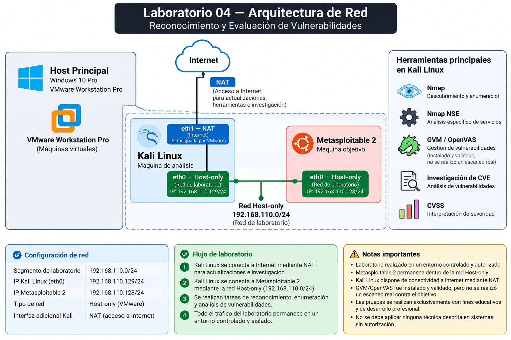
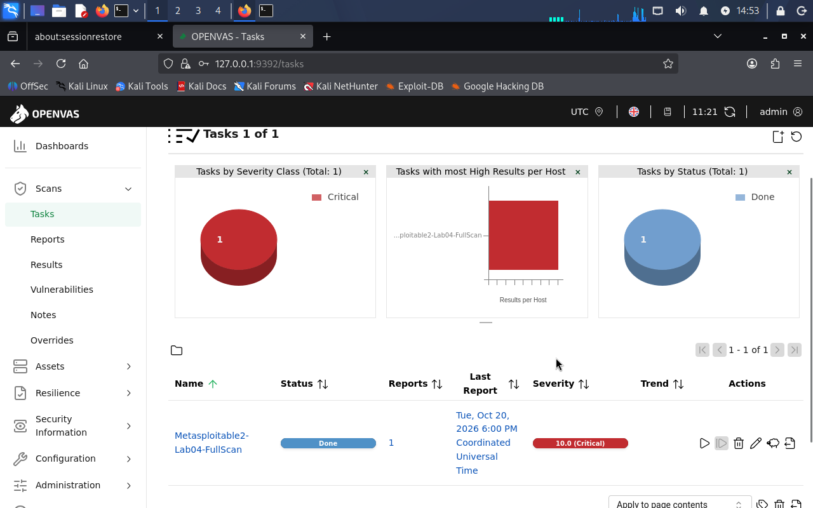
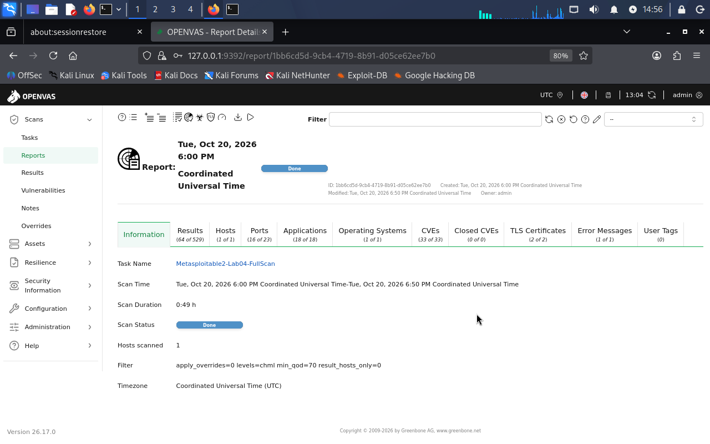
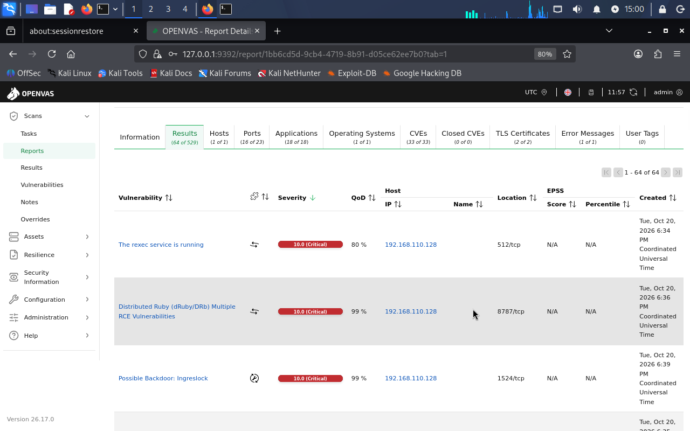
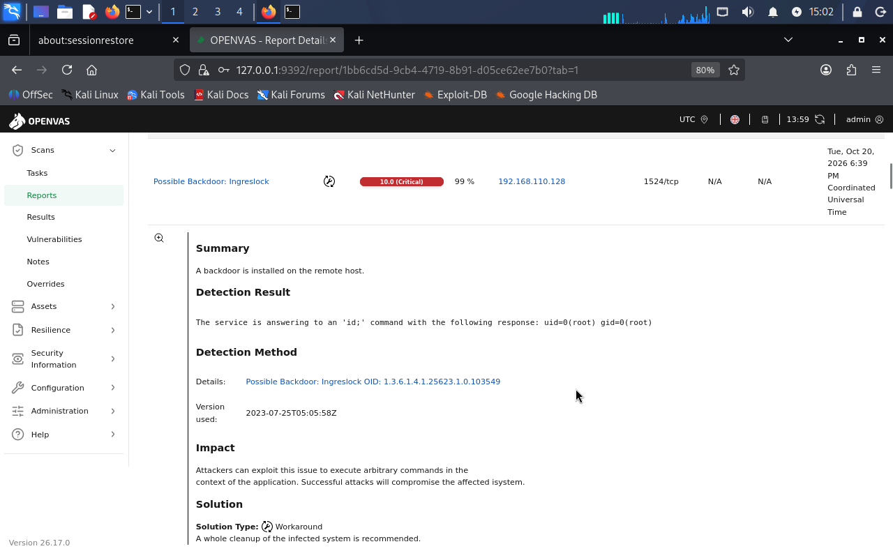
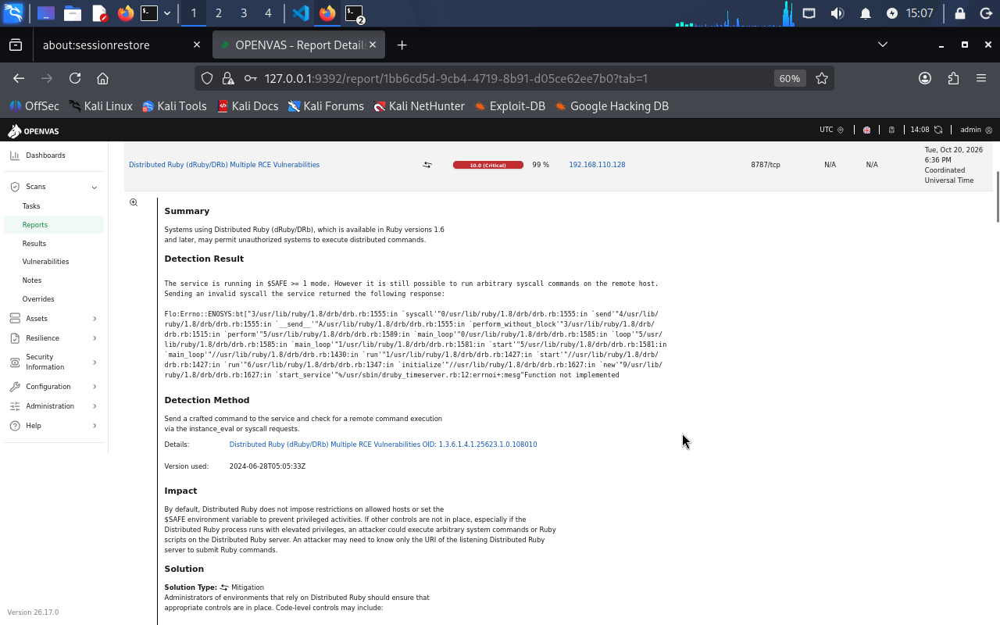
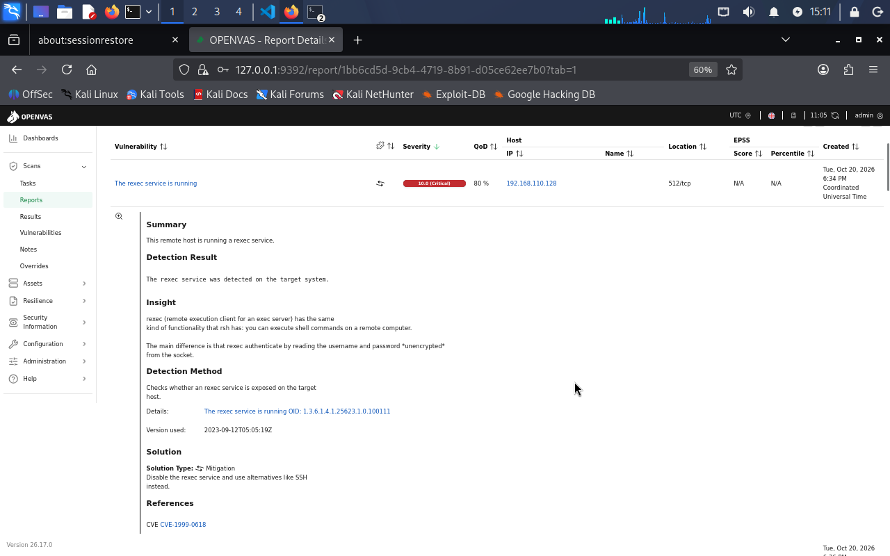
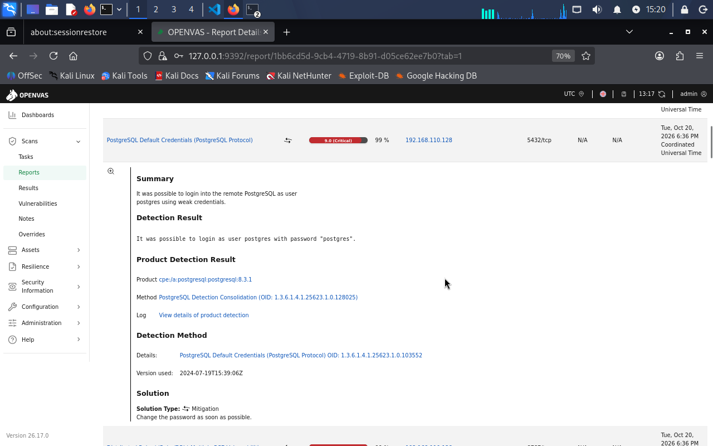
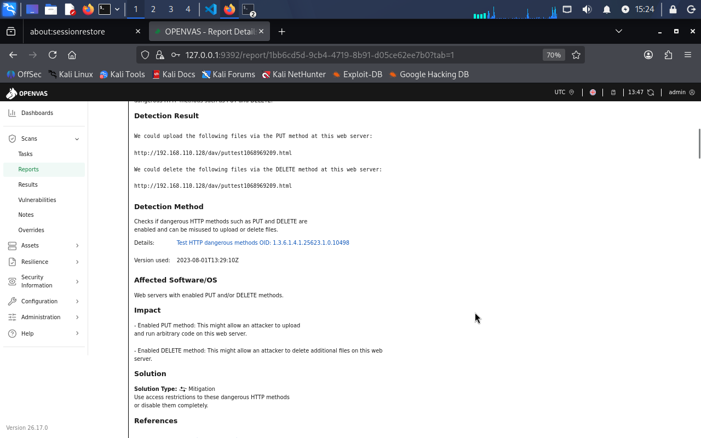

# Laboratorio 04 — Reconocimiento y Evaluación de Vulnerabilidades

## Descripción

Este laboratorio documenta un proceso completo de **reconocimiento, enumeración de servicios, investigación de vulnerabilidades y validación automatizada mediante GVM/OpenVAS** sobre un entorno controlado y autorizado.

El objetivo fue analizar la superficie de exposición de una máquina vulnerable, identificar servicios y versiones, investigar vulnerabilidades conocidas, interpretar CVE y CVSS, validar hallazgos mediante un escáner de vulnerabilidades y priorizar riesgos desde una perspectiva de **SOC, Blue Team y gestión de vulnerabilidades**.

La metodología utilizada durante todo el laboratorio fue:

> **Evidencia → Interpretación → Validación → Riesgo → Recomendación**

---

## Objetivo general

Realizar una evaluación de seguridad sobre un sistema vulnerable dentro de un laboratorio controlado, combinando reconocimiento manual y análisis automatizado para identificar, validar y priorizar vulnerabilidades y configuraciones inseguras.

---

## Objetivos específicos

- Identificar hosts activos dentro del segmento del laboratorio.
- Detectar puertos abiertos.
- Identificar servicios y versiones.
- Realizar enumeración específica sobre servicios expuestos.
- Detectar configuraciones inseguras.
- Investigar vulnerabilidades públicas mediante CVE.
- Interpretar puntuaciones CVSS.
- Diferenciar vulnerabilidades potenciales de vulnerabilidades confirmadas.
- Considerar posibles falsos positivos.
- Ejecutar un escaneo de vulnerabilidades con GVM/OpenVAS.
- Correlacionar resultados de Nmap y OpenVAS.
- Evaluar el riesgo contextual de los hallazgos.
- Priorizar vulnerabilidades.
- Proponer medidas de mitigación.
- Documentar únicamente evidencias relevantes.

---

## Entorno del laboratorio

Todas las actividades fueron realizadas exclusivamente dentro de un entorno autorizado y aislado.

| Componente | Configuración |
|---|---|
| Hipervisor | VMware Workstation Pro |
| Host físico | Windows 10 Pro |
| Máquina de análisis | Kali Linux |
| IP Kali — laboratorio | `192.168.110.129/24` |
| Máquina objetivo | Metasploitable 2 |
| IP objetivo | `192.168.110.128/24` |
| Segmento de laboratorio | `192.168.110.0/24` |
| Red del laboratorio | Host-only |
| Interfaz adicional de Kali | NAT para acceso a Internet |
| RAM final de Kali | 8 GB |

---

## Arquitectura



La máquina Metasploitable 2 permanece dentro de una red Host-only utilizada exclusivamente para las pruebas del laboratorio.

Kali Linux dispone adicionalmente de conectividad NAT para actualizar herramientas, sincronizar feeds e investigar vulnerabilidades sin exponer directamente la máquina objetivo.

La arquitectura permite mantener separado el sistema deliberadamente vulnerable de otras redes mientras la máquina de análisis conserva los recursos necesarios para realizar la investigación.

---

## Herramientas utilizadas

### Nmap

Utilizado para:

- descubrimiento de hosts;
- identificación de puertos;
- detección de servicios;
- detección de versiones;
- enumeración específica mediante NSE.

### Nmap Scripting Engine

Utilizado para profundizar en determinados servicios y configuraciones.

En particular, se utilizó para analizar los algoritmos criptográficos soportados por SSH.

### GVM / OpenVAS

Utilizado para:

- sincronización de Vulnerability Tests;
- ejecución de un escaneo `Full and fast`;
- detección automatizada de vulnerabilidades;
- validación activa de determinados hallazgos;
- asociación de resultados con CVE;
- análisis de severidad;
- análisis de Quality of Detection (QoD).

### CVE / CVSS

Utilizados para investigar vulnerabilidades públicamente documentadas y diferenciar severidad técnica de riesgo contextual.

---

# Metodología

El flujo general utilizado fue:

```text
Descubrimiento
      ↓
Escaneo de puertos
      ↓
Detección de servicios y versiones
      ↓
Enumeración específica
      ↓
Investigación de CVE
      ↓
Escaneo con OpenVAS
      ↓
Validación de hallazgos
      ↓
Evaluación del riesgo
      ↓
Priorización
      ↓
Mitigación
```

Durante todo el proceso se evitó considerar automáticamente una coincidencia de producto o versión como una vulnerabilidad confirmada.

---

# Reconocimiento y detección de servicios

Después de identificar los puertos disponibles en el sistema objetivo se realizó detección de servicios y versiones mediante Nmap.

```bash
sudo nmap -sV -p 21,22,23,25,53,80,111,139,445,512,513,514,1099,1524,2049,2121,3306,5432,5900,6000,6667,8009,8180 192.168.110.128
```

Entre los servicios identificados se encontraron:

| Puerto | Servicio | Producto / versión |
|---:|---|---|
| 21/tcp | FTP | vsftpd 2.3.4 |
| 22/tcp | SSH | OpenSSH 4.7p1 Debian 8ubuntu1 |
| 23/tcp | Telnet | Linux telnetd |
| 25/tcp | SMTP | Postfix smtpd |
| 53/tcp | DNS | ISC BIND 9.4.2 |
| 80/tcp | HTTP | Apache httpd 2.2.8 |
| 111/tcp | RPC | rpcbind |
| 139/tcp | SMB | Samba smbd 3.X - 4.X |
| 445/tcp | SMB | Samba smbd 3.X - 4.X |
| 512/tcp | exec | netkit-rsh rexecd |
| 513/tcp | login | rlogin |
| 514/tcp | shell | Netkit rshd |
| 1099/tcp | Java RMI | GNU Classpath grmiregistry |
| 1524/tcp | shell | Metasploitable root shell |
| 2049/tcp | NFS | NFS |
| 2121/tcp | FTP | ProFTPD 1.3.1 |
| 3306/tcp | MySQL | MySQL 5.0.51a |
| 5432/tcp | PostgreSQL | PostgreSQL |
| 5900/tcp | VNC | VNC protocol 3.3 |
| 6000/tcp | X11 | X11 |
| 6667/tcp | IRC | UnrealIRCd |
| 8009/tcp | AJP13 | Apache JServ |
| 8180/tcp | HTTP | Apache Tomcat/Coyote |

La cantidad de servicios disponibles evidencia una superficie de exposición considerable.

---

## Evidencia — detección de servicios


La detección de versiones fue utilizada como punto de partida para seleccionar servicios que requerían investigación adicional.

---

# Enumeración de SSH

El servicio SSH fue analizado mediante scripts NSE:

```bash
sudo nmap -p 22 --script ssh-hostkey,ssh2-enum-algos 192.168.110.128
```

La enumeración identificó algoritmos heredados como:

```text
diffie-hellman-group-exchange-sha1
diffie-hellman-group14-sha1
diffie-hellman-group1-sha1
ssh-dss
hmac-md5
hmac-sha1
```

También se encontraron múltiples cifrados CBC.

## Evidencia


Este resultado fue clasificado como:

> **Configuración criptográfica insegura confirmada.**

No se asignó artificialmente un CVE únicamente por encontrar algoritmos antiguos habilitados.

---

# Investigación CVE previa al escaneo automatizado

Antes de utilizar OpenVAS se investigaron vulnerabilidades relacionadas con algunos de los servicios encontrados mediante Nmap.

| Producto / servicio | CVE investigado | Evaluación |
|---|---|---|
| vsftpd 2.3.4 | CVE-2011-2523 | Potencial |
| Samba | CVE-2007-2447 | Aplicabilidad no confirmada |
| distccd | CVE-2004-2687 | Potencial |
| SSH | N/A | Configuración insegura confirmada |

Esta fase permitió establecer una regla importante:

> **Versión coincidente ≠ vulnerabilidad confirmada**

Una coincidencia de producto y versión constituye un punto de partida para investigar, pero no una prueba definitiva de vulnerabilidad.

---

# Implementación de GVM / OpenVAS

GVM/OpenVAS fue instalado y posteriormente verificado mediante:

```bash
sudo gvm-check-setup
```

La comprobación confirmó que estaban disponibles los principales componentes:

- OpenVAS Scanner;
- Notus Scanner;
- Greenbone Vulnerability Manager;
- Greenbone Security Assistant;
- PostgreSQL;
- Nmap;
- feeds de vulnerabilidades.

Los servicios fueron iniciados mediante:

```bash
sudo gvm-start
```

La interfaz quedó disponible en:

```text
https://127.0.0.1:9392
```

---

# Problema durante la carga de Vulnerability Tests

Durante la preparación del escaneo se observó que:

```text
Security Information → NVTs
```

mostraba:

```text
0 NVTs
```

Además, la configuración:

```text
Full and fast
```

no aparecía disponible al intentar crear una tarea de escaneo.

Inicialmente se comprobó que los archivos de configuración y los Vulnerability Tests existían localmente.

También se sincronizó el feed mediante:

```bash
sudo runuser -u _gvm -- greenbone-feed-sync --type nvt
```

Sin embargo, el problema continuó.

---

# Diagnóstico mediante logs

Se analizaron los logs de:

```text
ospd-openvas
gvmd
```

utilizando herramientas como:

```bash
sudo systemctl status gvmd --no-pager -l
```

y:

```bash
sudo journalctl -u gvmd -n 80 --no-pager
```

Los registros mostraron repetidamente:

```text
The kernel OOM killer killed some processes in this unit.
```

Durante la importación de los Vulnerability Tests, `gvmd` llegaba a consumir aproximadamente:

```text
2.3 GB - 2.6 GB
```

de memoria.

---

# OOM Killer

El **OOM Killer — Out Of Memory Killer** es un mecanismo del kernel Linux que termina procesos cuando el sistema se queda sin memoria suficiente para continuar funcionando.

La máquina Kali tenía inicialmente aproximadamente:

```text
RAM total: 3.8 GiB
Swap: 953 MiB
```

El comportamiento observado era:

```text
gvmd inicia importación
        ↓
aumenta consumo de RAM
        ↓
RAM y swap se agotan
        ↓
Linux activa OOM Killer
        ↓
gvmd es terminado
        ↓
systemd reinicia gvmd
        ↓
la importación vuelve a comenzar
```

Esto explicaba por qué Greenbone permanecía con:

```text
NVTs 0 of 0
```

---

# Solución del problema de memoria

La máquina Kali fue apagada y se aumentó la memoria asignada desde VMware Workstation Pro.

Configuración inicial:

```text
~4 GB RAM
```

Configuración final:

```text
8 GB RAM
```

Después del cambio:

```bash
free -h
```

mostró aproximadamente:

```text
Memoria total: 7.7 GiB
Memoria disponible: >6 GiB
Swap utilizado: 0
```

---

# Carga correcta de los Vulnerability Tests

Después de aumentar la memoria se iniciaron nuevamente los servicios:

```bash
sudo gvm-start
```

Se monitorizó el scanner mediante:

```bash
sudo tail -f /var/log/gvm/ospd-openvas.log
```

OpenVAS finalmente informó:

```text
Finished loading VTs.
The VT cache has been updated from version 0 to 202610200609.
```

Posteriormente la interfaz mostró:

```text
190521 NVTs
```

y la configuración:

```text
Full and fast
```

quedó disponible.

Este problema permitió practicar un proceso real de diagnóstico utilizando:

```text
síntoma
   ↓
logs
   ↓
hipótesis
   ↓
validación
   ↓
causa raíz
   ↓
solución
```

---

# Configuración del escaneo

Se creó el objetivo:

```text
Nombre: Metasploitable2-Lab04
Host: 192.168.110.128
Port List: All IANA assigned TCP
```

Posteriormente se creó la tarea:

```text
Nombre: Metasploitable2-Lab04-FullScan
Scanner: OpenVAS Default
Scan Config: Full and fast
Target: Metasploitable2-Lab04
```

El análisis se ejecutó exclusivamente contra la máquina autorizada del laboratorio.

---

# Resultado del escaneo OpenVAS

La tarea terminó correctamente.

## Resumen

```text
Estado: Done
Duración aproximada: 49 minutos
Hosts analizados: 1
Puertos identificados: 23
Aplicaciones: 18
Sistemas operativos: 1
CVE asociados: 33
Resultados totales: 529
Severidad máxima: 10.0 Critical
```

---

## Evidencia — escaneo completado



---

## Evidencia — resumen del reporte



---

## Evidencia — hallazgos críticos



No se documentaron individualmente los 529 resultados.

Se seleccionaron los hallazgos que aportaban mayor valor técnico y mejor calidad de evidencia.

---

# Hallazgo crítico — Shell remota con privilegios root

OpenVAS identificó:

```text
Possible Backdoor: Ingreslock

Host: 192.168.110.128
Puerto: 1524/tcp
Severidad: 10.0 Critical
QoD: 99 %
```

Durante la validación, OpenVAS envió:

```text
id
```

y recibió:

```text
uid=0(root) gid=0(root)
```

Esto constituye evidencia directa de ejecución remota de comandos con privilegios `root`.

## Evidencia



## Clasificación

> **Vulnerabilidad confirmada.**

## Riesgo

**Crítico.**

El acceso remoto como root supone control total sobre el sistema.

Un atacante podría potencialmente:

- leer cualquier información;
- modificar archivos;
- eliminar información;
- instalar software;
- crear persistencia;
- modificar cuentas;
- utilizar el sistema para ataques posteriores.

## Recomendación

En un sistema real:

- aislar inmediatamente el activo;
- eliminar la puerta trasera;
- investigar su origen;
- revisar mecanismos de persistencia;
- reconstruir el sistema desde una fuente confiable cuando corresponda;
- aplicar firewall y segmentación;
- realizar un nuevo escaneo.

---

# Hallazgo crítico — dRuby/DRb RCE

OpenVAS identificó:

```text
Distributed Ruby (dRuby/DRb) Multiple RCE Vulnerabilities

Puerto: 8787/tcp
Severidad: 10.0 Critical
QoD: 99 %
```

El scanner realizó una comprobación activa utilizando mecanismos relacionados con:

```text
instance_eval
syscall
```

El servicio procesó la solicitud y devolvió información interna del entorno Ruby.

## Evidencia



## Clasificación

> **Vulnerabilidad confirmada con alta confianza.**

No se realizó una explotación adicional para obtener una shell porque no era necesaria para demostrar el riesgo dentro del objetivo defensivo del laboratorio.

## Riesgo

**Crítico.**

La condición podría permitir ejecución remota de código o comandos bajo los privilegios del proceso afectado.

## Recomendación

- Deshabilitar dRuby si no es necesario.
- Actualizar Ruby.
- Actualizar aplicaciones dependientes.
- Aplicar mínimo privilegio.
- Restringir TCP/8787.
- Utilizar firewall y segmentación.
- Reescanear después de la remediación.

---

# Hallazgo crítico — rexec expuesto

Nmap había identificado:

```text
512/tcp open exec netkit-rsh rexecd
```

Posteriormente OpenVAS reportó:

```text
The rexec service is running

Puerto: 512/tcp
Severidad: 10.0 Critical
QoD: 80 %
CVE: CVE-1999-0618
```

## Evidencia



## Clasificación

> **Servicio remoto inseguro confirmado.**

El protocolo `rexec` utiliza mecanismos de autenticación heredados y no proporciona las garantías criptográficas de protocolos modernos como SSH.

## Riesgo

**Alto / Crítico según el contexto.**

La exposición de este tipo de servicio puede facilitar:

- exposición de credenciales;
- ejecución remota autenticada;
- ataques contra cuentas;
- movimiento posterior dentro de una red.

## Recomendación

- Deshabilitar `rexec`.
- Deshabilitar también `rsh` y `rlogin`.
- Sustituir los servicios por SSH.
- Restringir TCP/512.
- Aplicar firewall.
- Aplicar segmentación.

---

# Hallazgo crítico — Credenciales predeterminadas PostgreSQL

OpenVAS identificó:

```text
PostgreSQL Default Credentials

Puerto: 5432/tcp
Severidad: 9.0 Critical
QoD: 99 %
```

El scanner consiguió autenticarse utilizando:

```text
Usuario: postgres
Contraseña: postgres
```

## Evidencia



## Clasificación

> **Debilidad de autenticación confirmada.**

No se trata de una inferencia basada en versión.

OpenVAS consiguió realizar una autenticación real.

## Riesgo

**Crítico.**

Dependiendo de los privilegios disponibles, un atacante podría:

- consultar información;
- modificar registros;
- eliminar información;
- modificar bases de datos;
- crear usuarios;
- alterar configuraciones;
- utilizar el servicio como punto de entrada.

## Recomendación

- Cambiar inmediatamente las credenciales.
- Utilizar contraseñas robustas y únicas.
- Aplicar mínimo privilegio.
- Restringir TCP/5432.
- Limitar conexiones a hosts autorizados.
- Revisar cuentas existentes.
- Monitorizar intentos de autenticación.
- Reescanear después de la remediación.

---

# Hallazgo High — Métodos HTTP peligrosos

OpenVAS identificó:

```text
Test HTTP dangerous methods

Puerto: 80/tcp
Severidad: 7.5 High
QoD: 99 %
```

Durante la prueba se comprobó que estaban funcionales:

```text
PUT
DELETE
```

OpenVAS consiguió:

```text
crear un archivo
        ↓
comprobar su existencia
        ↓
eliminar el archivo
```

mediante WebDAV.

## Evidencia



## Clasificación

> **Configuración HTTP/WebDAV insegura confirmada.**

## Riesgo

**Alto.**

Un atacante podría potencialmente:

- cargar archivos no autorizados;
- alojar contenido malicioso;
- modificar contenido web;
- eliminar archivos;
- afectar la disponibilidad;
- conseguir ejecución de código si los archivos cargados son posteriormente interpretados por el servidor.

## Recomendación

- Deshabilitar `PUT` y `DELETE` si no son necesarios.
- Deshabilitar WebDAV si no existe una necesidad operativa.
- Exigir autenticación.
- Aplicar mínimo privilegio.
- Revisar permisos de directorios web.
- Restringir acceso mediante firewall y segmentación.

---

# Correlación entre Nmap y OpenVAS

Una de las partes más importantes del laboratorio fue comprobar cómo el reconocimiento manual y el escaneo automatizado se complementan.

## TCP/1524

```text
Nmap
Metasploitable root shell

        ↓

OpenVAS
Possible Backdoor: Ingreslock
uid=0(root) gid=0(root)

        ↓

Conclusión
Ejecución remota como root confirmada
```

---

## PostgreSQL

```text
Nmap
5432/tcp → PostgreSQL

        ↓

OpenVAS
login exitoso postgres/postgres

        ↓

Conclusión
Credenciales débiles confirmadas
```

---

## rexec

```text
Nmap
512/tcp → netkit-rsh rexecd

        ↓

OpenVAS
The rexec service is running
CVE-1999-0618

        ↓

Conclusión
Servicio remoto inseguro confirmado
```

---

## HTTP/WebDAV

```text
Nmap
80/tcp → Apache HTTP

        ↓

OpenVAS
PUT y DELETE funcionales

        ↓

Conclusión
Configuración insegura confirmada
```

---

# Niveles de evidencia observados

El laboratorio permitió diferenciar distintos niveles de evidencia.

| Hallazgo | Evidencia | Clasificación |
|---|---|---|
| vsftpd 2.3.4 | Coincidencia de versión | Vulnerabilidad potencial |
| Samba | Producto detectado | CVE no confirmado |
| distccd | Servicio expuesto | Vulnerabilidad potencial |
| SSH | Algoritmos enumerados directamente | Configuración insegura confirmada |
| rexec | Nmap + OpenVAS | Servicio inseguro confirmado |
| PostgreSQL | Autenticación exitosa | Debilidad confirmada |
| HTTP PUT/DELETE | Operaciones reales | Configuración confirmada |
| dRuby | Prueba activa + QoD 99 % | Vulnerabilidad confirmada |
| TCP/1524 | Ejecución de `id` como root | Vulnerabilidad confirmada directamente |

Esta comparación demuestra por qué no todos los resultados deben recibir el mismo nivel de confianza.

---

# QoD — Quality of Detection

OpenVAS utiliza **QoD — Quality of Detection** para representar el nivel de confianza asociado al método utilizado para detectar un hallazgo.

Durante el laboratorio se observaron valores como:

```text
QoD 80 %
QoD 99 %
```

Un QoD elevado aumenta la confianza de la detección, especialmente cuando existe una comprobación activa.

Sin embargo:

> **QoD no sustituye el análisis humano ni la evaluación contextual.**

---

# CVSS frente a riesgo

Uno de los aprendizajes principales fue comprender que:

```text
CVSS ≠ Riesgo
```

CVSS representa principalmente la severidad técnica.

El riesgo contextual depende también de:

- exposición;
- importancia del activo;
- facilidad de explotación;
- controles existentes;
- impacto;
- probabilidad;
- calidad de detección;
- contexto operativo.

---

# Priorización final

| Prioridad | Hallazgo | Justificación |
|---|---|---|
| Crítica | Shell root TCP/1524 | Ejecución remota con privilegios root |
| Crítica | dRuby/DRb RCE | RCE con QoD 99 % |
| Crítica | PostgreSQL default credentials | Autenticación real confirmada |
| Alta / Crítica | rexec | Servicio remoto inseguro |
| Alta | HTTP PUT/DELETE | Escritura y eliminación remota confirmadas |
| Alta | vsftpd 2.3.4 | Software obsoleto y posible CVE crítico |
| Media | Algoritmos SSH heredados | Debilidad criptográfica confirmada |

---

# Estrategia de mitigación

Las principales medidas recomendadas son:

- eliminar servicios innecesarios;
- actualizar software obsoleto;
- aplicar parches;
- cambiar credenciales predeterminadas;
- utilizar contraseñas robustas y únicas;
- aplicar mínimo privilegio;
- deshabilitar servicios `rsh`, `rexec` y `rlogin`;
- sustituir protocolos heredados por SSH;
- deshabilitar algoritmos criptográficos débiles;
- deshabilitar `PUT` y `DELETE` cuando no sean necesarios;
- deshabilitar WebDAV si no existe una necesidad real;
- restringir servicios mediante firewall;
- segmentar la red;
- monitorizar intentos de autenticación y explotación;
- realizar un nuevo escaneo después de la remediación.

---

# Falsos positivos

El laboratorio permitió comprobar que:

```text
Servicio detectado
        ↓
Versión detectada
        ↓
Coincidencia con CVE
```

no significa automáticamente:

```text
Vulnerabilidad confirmada
```

Un resultado debe analizarse considerando:

- versión exacta;
- configuración;
- condiciones del CVE;
- exposición;
- controles existentes;
- método de detección;
- QoD;
- evidencia activa.

---

# Indicadores de Compromiso

No se identificaron Indicadores de Compromiso derivados de actividad maliciosa real.

Metasploitable 2 es una máquina creada deliberadamente con servicios y configuraciones vulnerables.

Por lo tanto:

> **Una vulnerabilidad confirmada no constituye automáticamente un IoC.**

La presencia de una puerta trasera intencional dentro de Metasploitable tampoco demuestra que un atacante externo haya comprometido nuestro entorno.

---

# MITRE ATT&CK

No se añadieron técnicas MITRE ATT&CK únicamente para ampliar la documentación.

MITRE ATT&CK describe comportamientos adversarios.

Este laboratorio estuvo orientado a gestión de vulnerabilidades y no a la investigación de un incidente activo.

Por este motivo, solo se utilizaría ATT&CK si existiera una relación técnicamente justificable con actividad adversaria observada.

---

# Automatización

Se evaluó la posibilidad de automatizar tareas utilizando:

- Python;
- Bash;
- PowerShell.

No se identificó una tarea repetitiva cuya automatización aportara suficiente valor para justificar la creación de un script únicamente para el portafolio.

Por esta razón no se creó una carpeta `Scripts/`.

---

# Gestión de evidencias

No se tomaron capturas de cada comando ejecutado.

Se conservaron únicamente aquellas que permiten demostrar:

- una habilidad;
- un resultado relevante;
- una vulnerabilidad;
- una configuración insegura;
- una validación activa;
- una conclusión utilizada posteriormente.

El criterio aplicado fue:

> **Calidad de evidencia > Cantidad de evidencia**

Entre las evidencias principales se encuentran:

```text
03-nmap-service-detection.png
08-ssh-legacy-algorithms.png
29-openvas-vulnerability-scan.png
30-openvas-report-summary.png
31-openvas-critical-findings.png
32-openvas-ingreslock-detail.png
33-openvas-druby-rce-detail.png
34-openvas-rexec-detail.png
35-openvas-postgresql-default-credentials.png
36-openvas-http-dangerous-methods.png
```

---

# Documentación técnica

La documentación complementaria se encuentra en:

```text
Notes/
├── commands.md
├── findings.md
└── notes.md
```

## `commands.md`

Documenta:

- comandos utilizados;
- propósito de cada comando;
- preparación de Kali;
- uso de Nmap;
- operación de GVM/OpenVAS;
- diagnóstico del problema de NVT;
- análisis del OOM Killer;
- solución aplicada.

## `findings.md`

Documenta:

- host;
- puerto;
- servicio;
- vulnerabilidad;
- CVE cuando aplica;
- CVSS;
- severidad;
- evidencia;
- impacto;
- posibilidad de falso positivo;
- recomendación;
- prioridad.

## `notes.md`

Contiene:

- fundamentos conceptuales;
- decisiones metodológicas;
- diferencias entre CVSS y riesgo;
- diferencias entre vulnerabilidad e IoC;
- interpretación de QoD;
- problemas encontrados;
- soluciones;
- lecciones aprendidas.

---

# Estructura final del laboratorio

```text
04-Vulnerability-Assessment/
├── README.md
├── Diagrams/
│   ├── lab04-architecture.drawio
│   └── lab04-architecture.png
├── Notes/
│   ├── commands.md
│   ├── findings.md
│   └── notes.md
└── Screenshots/
    ├── ...
    ├── 29-openvas-vulnerability-scan.png
    ├── 30-openvas-report-summary.png
    ├── 31-openvas-critical-findings.png
    ├── 32-openvas-ingreslock-detail.png
    ├── 33-openvas-druby-rce-detail.png
    ├── 34-openvas-rexec-detail.png
    ├── 35-openvas-postgresql-default-credentials.png
    └── 36-openvas-http-dangerous-methods.png
```

No se crearon carpetas innecesarias como:

```text
Logs/
Reports/
Scripts/
IOC/
MITRE/
Configurations/
Resources/
```

porque el contenido real del laboratorio no justificó su creación.

---

# Competencias demostradas

Este laboratorio permite demostrar competencias relevantes para posiciones como:

- Analista SOC Junior;
- Analista de Ciberseguridad;
- Analista de Vulnerabilidades;
- Blue Team.

Entre las habilidades practicadas se encuentran:

- reconocimiento de red;
- identificación de superficie de exposición;
- análisis de puertos;
- identificación de servicios;
- fingerprinting de versiones;
- enumeración mediante Nmap NSE;
- investigación de CVE;
- interpretación de CVSS;
- operación de GVM/OpenVAS;
- sincronización de feeds;
- análisis de NVT;
- interpretación de QoD;
- análisis de configuraciones inseguras;
- evaluación de falsos positivos;
- validación de vulnerabilidades;
- correlación entre herramientas;
- análisis de logs;
- diagnóstico de servicios Linux;
- resolución de problemas de memoria;
- análisis de OOM Killer;
- priorización;
- mitigación;
- documentación técnica.

---

# Principales aprendizajes

El laboratorio permitió comprobar que una evaluación de vulnerabilidades no consiste únicamente en ejecutar un escáner.

Los principales aprendizajes fueron:

- Un puerto abierto no representa automáticamente una vulnerabilidad.
- Una versión antigua no confirma automáticamente un CVE.
- Un CVE debe analizarse junto con sus condiciones específicas.
- CVSS representa severidad y no sustituye una evaluación de riesgo.
- QoD permite valorar la confianza del método de detección.
- Una validación activa ofrece evidencia más fuerte que una coincidencia de versión.
- Una vulnerabilidad puede existir sin un CVE específico.
- Una configuración insegura puede representar un riesgo importante.
- Los escáneres automáticos pueden generar falsos positivos.
- Los resultados deben ser interpretados por un analista.
- Los logs son fundamentales para diagnosticar herramientas de seguridad.
- Los recursos de infraestructura pueden afectar directamente una evaluación.
- No todos los resultados de un escáner deben documentarse.
- La calidad de la evidencia es más importante que la cantidad.
- Una vulnerabilidad confirmada no constituye automáticamente un IoC.

---

# Conclusiones

El laboratorio permitió realizar una evaluación completa de vulnerabilidades sobre:

```text
192.168.110.128
```

Nmap permitió construir inicialmente la superficie de exposición mediante la identificación de puertos, servicios y versiones.

La enumeración específica permitió detectar configuraciones inseguras, especialmente en SSH.

La investigación de CVE permitió analizar vulnerabilidades potencialmente relacionadas con los productos identificados sin asumir automáticamente que una coincidencia de versión representaba una vulnerabilidad confirmada.

Posteriormente, GVM/OpenVAS permitió realizar comprobaciones automatizadas y validar varios hallazgos importantes.

Entre las evidencias más relevantes se encontraron:

```text
TCP/1524
→ ejecución remota como root

TCP/8787
→ vulnerabilidad RCE en dRuby/DRb

TCP/5432
→ autenticación con credenciales predeterminadas

TCP/512
→ servicio rexec inseguro expuesto

TCP/80
→ métodos HTTP PUT y DELETE funcionales
```

El escaneo `Full and fast` produjo:

```text
529 resultados
33 CVE asociados
23 puertos
18 aplicaciones
Severidad máxima: 10.0 Critical
```

Sin embargo, solo se documentaron los hallazgos que aportaban evidencia relevante para el análisis.

Durante la implementación de OpenVAS también se resolvió un problema real de infraestructura.

La revisión de logs permitió identificar que `gvmd` estaba siendo terminado por el **OOM Killer** debido a recursos insuficientes.

Aumentar la memoria de Kali de aproximadamente 4 GB a 8 GB permitió completar correctamente la importación de más de 190.000 Vulnerability Tests y ejecutar la evaluación.

Este proceso demostró que una evaluación profesional de vulnerabilidades requiere combinar:

```text
Herramientas
+
Evidencia
+
Validación
+
Contexto
+
Análisis humano
```

La metodología final aplicada fue:

> **Identificar → Validar → Evaluar → Priorizar → Recomendar**

Desde una perspectiva SOC / Blue Team, el laboratorio permitió transformar información técnica obtenida mediante diferentes herramientas en hallazgos defendibles, priorizados y acompañados de recomendaciones de mitigación.

---

## Uso ético

Todas las pruebas documentadas en este laboratorio fueron realizadas exclusivamente dentro de un entorno controlado y autorizado con fines educativos y de desarrollo profesional.

Las técnicas descritas no deben utilizarse contra sistemas sin autorización.