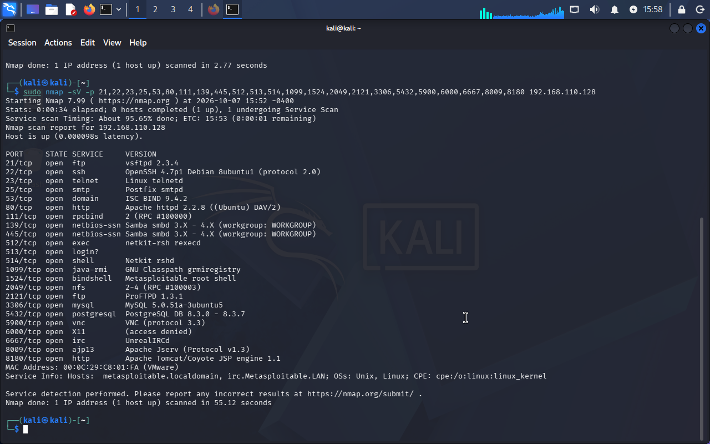
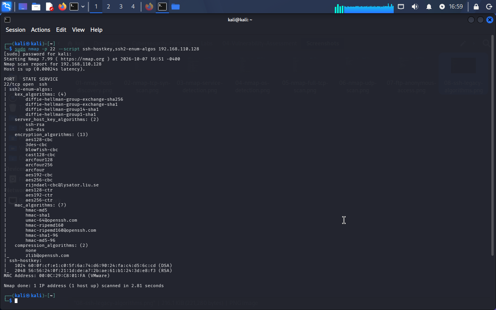

# Laboratorio 04 — Reconocimiento y Evaluación de Vulnerabilidades

## Descripción

Este laboratorio documenta un proceso de **reconocimiento, enumeración de servicios e investigación de vulnerabilidades** realizado sobre un entorno controlado y autorizado.

El objetivo principal fue analizar la superficie de exposición de una máquina vulnerable, identificar los servicios disponibles, investigar vulnerabilidades conocidas asociadas a las tecnologías detectadas y evaluar los resultados desde una perspectiva de **SOC, Blue Team y gestión de vulnerabilidades**.

Durante el laboratorio se utilizaron principalmente:

- Nmap para descubrimiento y enumeración.
- Nmap Scripting Engine (NSE) para análisis específico de servicios.
- Investigación de CVE.
- Interpretación de CVSS.
- Evaluación contextual del riesgo.
- Análisis de configuraciones inseguras.
- GVM/OpenVAS como plataforma de gestión de vulnerabilidades.

El análisis se realizó siguiendo el principio:

> **Evidencia → Interpretación → Riesgo → Recomendación**

---

# Objetivo general

Realizar una evaluación de seguridad sobre un sistema vulnerable dentro de un laboratorio controlado, identificando su superficie de exposición y analizando los hallazgos desde una perspectiva defensiva.

---

# Objetivos específicos

- Identificar hosts activos dentro del segmento de laboratorio.
- Detectar puertos TCP abiertos.
- Identificar servicios y versiones.
- Enumerar servicios relevantes.
- Detectar configuraciones inseguras.
- Investigar vulnerabilidades públicas mediante CVE.
- Interpretar puntuaciones CVSS.
- Diferenciar vulnerabilidades potenciales de vulnerabilidades confirmadas.
- Considerar posibles falsos positivos.
- Evaluar el riesgo contextual de los hallazgos.
- Proponer medidas de mitigación.
- Documentar únicamente evidencias relevantes.

---

# Entorno del laboratorio

Todas las actividades fueron realizadas exclusivamente dentro de un entorno autorizado y aislado.

| Componente | Configuración |
|---|---|
| Hipervisor | VMware Workstation Pro |
| Host | Windows 10 Pro |
| Máquina de análisis | Kali Linux |
| IP Kali — laboratorio | `192.168.110.129/24` |
| Máquina objetivo | Metasploitable 2 |
| IP objetivo | `192.168.110.128/24` |
| Segmento de laboratorio | `192.168.110.0/24` |
| Tipo de red del laboratorio | Host-only |
| Interfaz adicional Kali | NAT para acceso a Internet |

La máquina Metasploitable permanece dentro de la red Host-only utilizada para las pruebas del laboratorio.

Kali Linux dispone adicionalmente de conectividad mediante NAT para permitir consultas, actualización de paquetes e investigación de vulnerabilidades sin exponer directamente la máquina objetivo.

---

# Arquitectura

La arquitectura utilizada puede representarse de la siguiente manera:

```text
                         Internet
                            │
                            │ NAT
                            │
                    ┌───────────────┐
                    │  Kali Linux   │
                    │               │
                    │ eth1 — NAT    │
                    │               │
                    │ eth0          │
                    │192.168.110.129│
                    └───────┬───────┘
                            │
                            │ Host-only
                            │
                   192.168.110.0/24
                            │
                            │
                  ┌─────────┴─────────┐
                  │  Metasploitable 2 │
                  │                   │
                  │ 192.168.110.128   │
                  └───────────────────┘
```

Esta separación permite mantener la máquina vulnerable dentro de una red controlada mientras Kali conserva acceso a Internet para tareas administrativas e investigación.

---

# Herramientas utilizadas

## Nmap

Utilizado para:

- descubrimiento;
- identificación de puertos;
- detección de servicios;
- detección de versiones;
- enumeración específica mediante NSE.

## Nmap Scripting Engine

Utilizado para profundizar en determinados servicios.

En particular se utilizó para analizar la configuración criptográfica ofrecida por SSH.

## GVM / OpenVAS

GVM/OpenVAS fue instalado y validado correctamente en Kali Linux.

La instalación incluyó los componentes principales de la plataforma:

- OpenVAS;
- Notus;
- `gvmd`;
- `gsad`;
- PostgreSQL;
- feeds de vulnerabilidades.

La comprobación del entorno se realizó correctamente mediante las herramientas de verificación de GVM.

Sin embargo, durante esta versión del laboratorio **no se completó un escaneo real de vulnerabilidades contra el objetivo mediante OpenVAS**.

Por esta razón no se presentan resultados de OpenVAS como evidencia ni se atribuyen vulnerabilidades al sistema basándose en esta herramienta.

---

# Metodología

El flujo de trabajo utilizado fue:

```text
Descubrimiento
      ↓
Identificación de puertos
      ↓
Detección de servicios y versiones
      ↓
Enumeración específica
      ↓
Investigación de vulnerabilidades
      ↓
Análisis de CVE
      ↓
Interpretación de CVSS
      ↓
Evaluación del riesgo
      ↓
Priorización
      ↓
Recomendaciones
```

Durante todo el proceso se evitó considerar automáticamente una coincidencia de versión como una vulnerabilidad confirmada.

---

# Detección de servicios

Después de identificar los puertos disponibles se realizó detección de versiones mediante Nmap.

El comando utilizado fue:

```bash
sudo nmap -sV -p 21,22,23,25,53,80,111,139,445,512,513,514,1099,1524,2049,2121,3306,5432,5900,6000,6667,8009,8180 192.168.110.128
```

Entre los servicios identificados se encontraron:

| Puerto | Servicio | Producto / versión |
|---:|---|---|
| 21/tcp | FTP | vsftpd 2.3.4 |
| 22/tcp | SSH | OpenSSH 4.7p1 Debian 8ubuntu1 |
| 23/tcp | Telnet | Linux telnetd |
| 25/tcp | SMTP | Postfix smtpd |
| 53/tcp | DNS | ISC BIND 9.4.2 |
| 80/tcp | HTTP | Apache httpd 2.2.8 |
| 111/tcp | RPC | rpcbind |
| 139/tcp | SMB | Samba smbd 3.X - 4.X |
| 445/tcp | SMB | Samba smbd 3.X - 4.X |
| 512/tcp | exec | netkit-rsh rexecd |
| 513/tcp | login | rlogin |
| 514/tcp | shell | Netkit rshd |
| 1099/tcp | Java RMI | GNU Classpath grmiregistry |
| 1524/tcp | shell | Metasploitable root shell |
| 2049/tcp | NFS | NFS |
| 2121/tcp | FTP | ProFTPD 1.3.1 |
| 3306/tcp | MySQL | MySQL 5.0.51a-3ubuntu5 |
| 5432/tcp | PostgreSQL | PostgreSQL DB |
| 5900/tcp | VNC | VNC protocol 3.3 |
| 6000/tcp | X11 | X11 |
| 6667/tcp | IRC | UnrealIRCd |
| 8009/tcp | AJP13 | Apache JServ |
| 8180/tcp | HTTP | Apache Tomcat/Coyote |

La cantidad de servicios disponibles demuestra una superficie de exposición considerable.

Muchos de los productos identificados corresponden además a versiones antiguas o tecnologías que requieren controles adicionales de seguridad.

---

# Evidencia — detección de servicios



La detección de versiones se utilizó como punto inicial para seleccionar servicios que requerían una investigación adicional.

---

# Enumeración de SSH

El servicio SSH fue analizado mediante scripts NSE:

```bash
sudo nmap -p 22 --script ssh-hostkey,ssh2-enum-algos 192.168.110.128
```

La enumeración permitió identificar algoritmos heredados.

Entre ellos:

```text
diffie-hellman-group-exchange-sha1
diffie-hellman-group14-sha1
diffie-hellman-group1-sha1
ssh-dss
hmac-md5
hmac-sha1
```

También se encontraron múltiples cifrados CBC.

---

# Evidencia — algoritmos SSH heredados



Este resultado se clasificó como una **debilidad de configuración criptográfica**.

No se asignó artificialmente un CVE únicamente por la existencia de algoritmos antiguos.

---

# Investigación de vulnerabilidades

La información obtenida mediante Nmap fue utilizada para investigar vulnerabilidades públicamente documentadas.

La metodología aplicada fue:

```text
Servicio
   ↓
Producto
   ↓
Versión
   ↓
CVE asociado
   ↓
Condiciones del CVE
   ↓
Comparación con la evidencia
   ↓
Clasificación
```

Se analizaron principalmente los siguientes CVE:

| Producto / servicio | CVE investigado | CVSS | Evaluación |
|---|---|---:|---|
| vsftpd 2.3.4 | CVE-2011-2523 | 9.8 CVSS v3.1 | Potencial |
| Samba | CVE-2007-2447 | Histórico | Aplicabilidad no confirmada |
| distccd | CVE-2004-2687 | 9.3 CVSS v2 | Potencial |
| SSH | N/A | N/A | Configuración insegura confirmada |

---

# CVE-2011-2523 — vsftpd 2.3.4

Nmap identificó:

```text
21/tcp open ftp vsftpd 2.3.4
```

Esta versión se encuentra relacionada con **CVE-2011-2523**.

El CVE está asociado con copias comprometidas de vsftpd 2.3.4 que contenían una puerta trasera capaz de proporcionar ejecución remota.

### CVSS

```text
CVSS v3.1: 9.8 — Crítica
```

### Evaluación

Aunque la versión coincide con la relacionada con el CVE, la coincidencia por sí sola no demuestra que el binario instalado corresponda a una de las distribuciones comprometidas.

Por ello el hallazgo se clasificó como:

> **Vulnerabilidad potencial — no confirmada mediante explotación.**

### Riesgo

En caso de estar presente una versión comprometida, un atacante podría conseguir ejecución remota de comandos sin autenticación.

### Recomendaciones

- Actualizar o reemplazar la versión antigua de vsftpd.
- Comprobar la procedencia de los paquetes.
- Deshabilitar FTP cuando no sea necesario.
- Utilizar alternativas cifradas como SFTP.
- Restringir el acceso mediante firewall y segmentación.

---

# CVE-2007-2447 — Samba

Los puertos:

```text
139/tcp
445/tcp
```

mostraron servicios Samba.

Se investigó su posible relación con:

```text
CVE-2007-2447
```

Esta vulnerabilidad está relacionada con inyección de comandos en determinadas versiones y configuraciones antiguas de Samba.

### Evaluación

La evidencia conservada identifica Samba, pero no permite confirmar completamente todas las condiciones necesarias para atribuir CVE-2007-2447 al sistema.

Por esta razón:

> **CVE investigado — aplicabilidad no confirmada con la evidencia disponible.**

### Riesgo

En un sistema vulnerable y correctamente expuesto a las condiciones del CVE podría producirse ejecución remota de comandos.

### Recomendaciones

- Determinar la versión exacta instalada.
- Revisar la configuración de Samba.
- Actualizar versiones obsoletas.
- Eliminar accesos anónimos innecesarios.
- Restringir TCP/139 y TCP/445 mediante segmentación y firewall.

---

# CVE-2004-2687 — distccd

Durante la investigación de los servicios del entorno también se analizó la posible exposición de `distccd`.

El CVE investigado fue:

```text
CVE-2004-2687
```

Este problema se encuentra relacionado con instalaciones de distcc sin restricciones de acceso adecuadas.

### CVSS

```text
CVSS v2: 9.3
```

### Evaluación

La exposición del servicio puede ser compatible con las condiciones relacionadas con el CVE.

Sin embargo, la presencia del servicio no constituye por sí sola evidencia suficiente de explotación.

Por esta razón:

> **Vulnerabilidad potencial — requiere validación adicional de configuración.**

### Recomendaciones

- Deshabilitar distccd si no es necesario.
- Limitar los hosts autorizados.
- Restringir TCP/3632.
- Actualizar el software.
- Verificar posteriormente la remediación.

---

# Configuración criptográfica SSH insegura

A diferencia de los CVE anteriores, la enumeración SSH proporcionó evidencia directa de una debilidad de configuración.

Se identificaron mecanismos antiguos como:

```text
ssh-dss
diffie-hellman-group1-sha1
diffie-hellman-group14-sha1
hmac-md5
hmac-sha1
CBC
```

### Clasificación

> **Configuración insegura confirmada.**

Este hallazgo demuestra por qué no todos los problemas de seguridad necesitan tener asociado un CVE.

### Recomendaciones

- Eliminar `ssh-dss`.
- Deshabilitar algoritmos basados en SHA-1 cuando sea posible.
- Deshabilitar cifrados CBC antiguos.
- Eliminar mecanismos MAC basados en MD5.
- Utilizar algoritmos criptográficos modernos.
- Actualizar OpenSSH.

---

# CVSS frente a riesgo

Una de las conclusiones principales del laboratorio fue comprender que:

```text
CVSS ≠ Riesgo
```

CVSS representa principalmente la **severidad técnica** de una vulnerabilidad.

El riesgo debe considerar además:

- exposición;
- facilidad de explotación;
- importancia del activo;
- impacto;
- controles existentes;
- confianza en el hallazgo;
- posibilidad de falso positivo.

Por ello una vulnerabilidad con puntuación elevada no debe priorizarse automáticamente sin analizar el contexto.

---

# Priorización

Considerando los resultados obtenidos, una priorización defensiva sería:

| Prioridad | Hallazgo | Justificación |
|---|---|---|
| Crítica / Alta | vsftpd 2.3.4 | Posible relación con ejecución remota y software extremadamente obsoleto |
| Alta | Servicios de administración y acceso remoto antiguos | Aumentan considerablemente la superficie de ataque |
| Alta | Samba expuesto | Servicio sensible y software antiguo que requiere validación |
| Alta | distccd potencialmente expuesto | Posibilidad de ejecución remota si existen condiciones vulnerables |
| Media | Algoritmos SSH heredados | Debilidad criptográfica confirmada |
| Media | Divulgación de versiones | Facilita reconocimiento y selección de vulnerabilidades |

La priorización definitiva siempre debe ajustarse al contexto real del activo.

---

# Estrategia de mitigación

Las principales medidas recomendadas son:

| Acción | Aplicación |
|---|---|
| Actualización | Sustituir software y versiones sin soporte |
| Parcheo | Aplicar correcciones de seguridad disponibles |
| Hardening | Deshabilitar algoritmos y configuraciones inseguras |
| Segmentación | Separar servicios críticos o vulnerables |
| Firewall | Limitar acceso únicamente a sistemas autorizados |
| Reducción de superficie | Deshabilitar servicios innecesarios |
| Autenticación | Evitar accesos anónimos o inseguros |
| Monitoreo | Detectar intentos de acceso o explotación |
| Reescaneo | Validar posteriormente la corrección |

---

# Falsos positivos

La investigación demostró que una herramienta puede identificar una versión aparentemente vulnerable sin que esto demuestre necesariamente que el sistema sea explotable.

Por ejemplo:

```text
Versión encontrada
        ↓
Coincidencia con CVE
        ↓
Posible vulnerabilidad
```

no debe interpretarse directamente como:

```text
Vulnerabilidad confirmada
```

También deben comprobarse:

- condiciones del CVE;
- configuración;
- paquetes instalados;
- parches;
- exposición;
- controles compensatorios.

Este criterio es especialmente importante en gestión profesional de vulnerabilidades.

---

# Indicadores de Compromiso

No se identificaron **Indicadores de Compromiso (IoC)** durante este laboratorio.

Los elementos encontrados corresponden a:

- puertos abiertos;
- servicios;
- versiones;
- vulnerabilidades potenciales;
- configuraciones inseguras.

Estos elementos representan superficie de exposición o riesgo, pero **no demuestran que el sistema haya sido comprometido**.

Por lo tanto:

> Una vulnerabilidad o un CVE no constituye automáticamente un IoC.

---

# MITRE ATT&CK

No se añadieron técnicas MITRE ATT&CK de forma artificial.

MITRE ATT&CK describe comportamiento adversario, mientras que este laboratorio se centró principalmente en reconocimiento y gestión de vulnerabilidades.

Relacionar un CVE o un puerto abierto directamente con una técnica ATT&CK sin evidencia de comportamiento adversario podría generar una conclusión incorrecta.

---

# Automatización

Se evaluó la posibilidad de crear automatizaciones con:

- Python;
- Bash;
- PowerShell.

Sin embargo, no se identificó una tarea repetitiva cuya automatización aportara suficiente valor al laboratorio.

Por esta razón no se creó un script únicamente para ampliar artificialmente el repositorio.

---

# Gestión de evidencias

Durante el laboratorio no se tomaron capturas de cada comando.

Únicamente se conservaron evidencias con valor técnico.

Ejemplos:

```text
Screenshots/
├── 03-nmap-service-detection.png
└── 08-ssh-legacy-algorithms.png
```

El criterio utilizado fue:

> **Calidad de evidencia > Cantidad de evidencia**

---

# Documentación técnica

La documentación complementaria se encuentra en:

```text
Notes/
├── commands.md
├── findings.md
└── notes.md
```

### `commands.md`

Contiene los comandos ejecutados y explica su propósito.

### `findings.md`

Documenta los principales hallazgos, CVE investigados, riesgos, falsos positivos y recomendaciones.

### `notes.md`

Contiene conceptos, decisiones metodológicas y aprendizajes obtenidos durante el laboratorio.

---

# Estructura del laboratorio

```text
04-Vulnerability-Assessment/
├── README.md
├── Notes/
│   ├── commands.md
│   ├── findings.md
│   └── notes.md
└── Screenshots/
    ├── 03-nmap-service-detection.png
    └── 08-ssh-legacy-algorithms.png
```

La estructura se mantuvo deliberadamente reducida.

No se crearon carpetas como:

```text
Logs/
Reports/
Scripts/
IOC/
MITRE/
Configurations/
Resources/
```

porque no existe contenido real que justifique su incorporación en esta versión del laboratorio.

---

# Limitaciones del laboratorio

GVM/OpenVAS fue instalado y verificado correctamente, pero no se completó un escaneo real contra `192.168.110.128`.

Por esta razón:

- no se muestran resultados de OpenVAS;
- no se atribuyen vulnerabilidades basándose en OpenVAS;
- no se incluye una captura de un escaneo inexistente;
- los CVE documentados corresponden a investigación derivada de la enumeración realizada;
- las vulnerabilidades no confirmadas se mantienen expresamente clasificadas como potenciales.

Esta limitación se documenta para mantener la trazabilidad y evitar presentar como evidencia una actividad que no fue realizada.

---

# Competencias demostradas

Este laboratorio permitió desarrollar y demostrar competencias relevantes para posiciones como:

- Analista SOC Junior;
- Analista de Ciberseguridad;
- Analista de Vulnerabilidades;
- Blue Team.

Entre las habilidades practicadas se encuentran:

- reconocimiento de red;
- identificación de superficie de ataque;
- análisis de puertos;
- detección de servicios;
- fingerprinting de versiones;
- enumeración mediante Nmap NSE;
- investigación de CVE;
- interpretación de CVSS;
- análisis de configuraciones inseguras;
- evaluación de falsos positivos;
- gestión de vulnerabilidades;
- análisis contextual del riesgo;
- priorización;
- elaboración de recomendaciones;
- documentación técnica.

---

# Principales aprendizajes

El laboratorio permitió comprobar que una evaluación de vulnerabilidades no consiste únicamente en ejecutar un escáner.

Los principales aprendizajes fueron:

- Un puerto abierto no representa automáticamente una vulnerabilidad.
- Una versión antigua no confirma automáticamente un CVE.
- Un CVE debe analizarse junto con sus condiciones de explotación.
- CVSS representa severidad y no sustituye una evaluación de riesgo.
- Las configuraciones inseguras pueden ser importantes aunque no tengan un CVE.
- Los falsos positivos deben considerarse durante cualquier evaluación.
- La explotación no siempre es necesaria para documentar un riesgo.
- La superficie de exposición debe analizarse de forma contextual.
- Una vulnerabilidad no constituye automáticamente un IoC.
- La evidencia debe respaldar cada conclusión técnica.

---

# Conclusiones

El análisis de `192.168.110.128` permitió identificar una superficie de exposición amplia compuesta por numerosos servicios accesibles y tecnologías antiguas.

La enumeración mostró servicios como FTP, SSH, Telnet, HTTP, SMB, NFS, bases de datos, VNC, IRC y servidores de aplicaciones.

A partir de esta información se investigaron vulnerabilidades conocidas y se analizaron posibles relaciones con CVE.

El laboratorio permitió diferenciar correctamente entre:

```text
Servicio expuesto
Vulnerabilidad potencial
Vulnerabilidad confirmada
Configuración insegura
Software obsoleto
Falso positivo
```

Uno de los aprendizajes más importantes fue evitar considerar una coincidencia automática de producto y versión como prueba suficiente de una vulnerabilidad.

Desde una perspectiva SOC / Blue Team, el proceso permitió practicar una metodología basada en:

> **Identificar → Validar → Evaluar → Priorizar → Recomendar**

El resultado final no busca mostrar la mayor cantidad posible de vulnerabilidades, sino demostrar la capacidad de interpretar evidencia técnica y convertirla en información útil para la gestión defensiva del riesgo.

---

## Uso ético

Todas las pruebas documentadas en este laboratorio fueron realizadas exclusivamente dentro de un entorno controlado y autorizado con fines educativos y de desarrollo profesional.

Las técnicas descritas no deben utilizarse contra sistemas sin autorización.